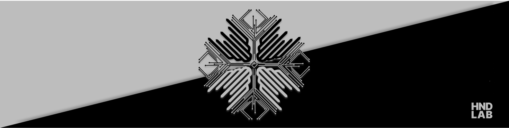

  

# G-docs

Documentacao tecnica principal do sistema desktop local para controle de recebimento de documentos por empresa.

Este `README` agora funciona como capa e indice da documentacao. O detalhamento completo foi separado em arquivos `.md` por topico dentro da pasta [`docs/`](docs).

## Navegacao
- [1. Visao Geral Do Sistema](docs/01-visao-geral-do-sistema.md)
- [2. Estrutura De Pastas E Arquivos](docs/02-estrutura-de-pastas-e-arquivos.md)
- [3. Arquitetura Geral Do Projeto](docs/03-arquitetura-geral-do-projeto.md)
- [4. Hierarquia Das Classes](docs/04-hierarquia-das-classes.md)
- [5. Documentacao Completa Das Classes](docs/05-documentacao-completa-das-classes.md)
- [6. Documentacao Completa Das Funcoes E Metodos](docs/06-documentacao-completa-das-funcoes-e-metodos.md)
- [7. Relacionamento Entre Classes](docs/07-relacionamento-entre-classes.md)
- [8. Mapa De Chamadas Entre Classes E Modulos](docs/08-mapa-de-chamadas-entre-classes-e-modulos.md)
- [9. Fluxos Importantes Do Sistema](docs/09-fluxos-importantes-do-sistema.md)
- [10. Banco De Dados](docs/10-banco-de-dados.md)
- [11. Regras De Negocio](docs/11-regras-de-negocio.md)
- [12. Interface Do Sistema](docs/12-interface-do-sistema.md)
- [13. Dependencias E Bibliotecas Usadas](docs/13-dependencias-e-bibliotecas-usadas.md)
- [14. UML Textual / Diagrama Descritivo](docs/14-uml-textual-diagrama-descritivo.md)
- [15. Ordem Ideal Para Estudar O Projeto](docs/15-ordem-ideal-para-estudar-o-projeto.md)
- [16. Pontos De Melhoria E Refatoracao](docs/16-pontos-de-melhoria-e-refatoracao.md)
- [17. Resumo Final](docs/17-resumo-final.md)
- [18. Icones E Empacotamento Por Sistema Operacional](docs/18-icones-e-empacotamento-por-sistema-operacional.md)
- [19. Observacoes Importantes Para Git E Empacotamento](docs/19-observacoes-importantes-para-git-e-empacotamento.md)
- [20. Encerramento](docs/20-encerramento.md)

## Observacao

- A imagem de capa usada neste arquivo esta em [`assets/capa.png`](assets/capa.png).
- Os topicos foram separados para facilitar estudo, manutencao e consulta por assunto.
- O conteudo tecnico detalhado continua preservado nos arquivos da pasta [`docs/`](docs).
